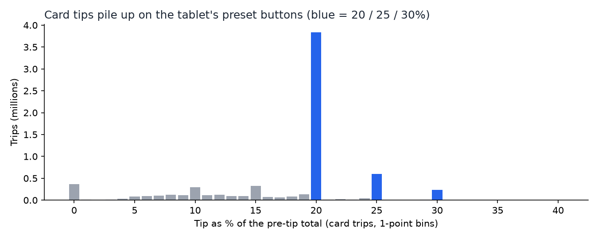

# NYC Taxi SQL Analytics

SQL analytics over **9.55 million** NYC yellow-taxi trips (January–March 2024), queried directly from parquet with DuckDB. It covers:
- a data-quality audit that accounts for every row,
- demand by hour and weekday,
- Manhattan traffic speed,
- airport economics,
- robust detection of anomalous days,
- a measurement of how much the tablet's preset tip buttons shape tipping.

> **Status: learning project (September 2026).** It is built, tested, and run on the real TLC data, but I am still practising explaining it. The findings describe three winter months of yellow-taxi records only, not NYC traffic or ride-hailing in general.



## Quickstart

```bash
cd nyc-taxi-sql-analytics
python3 -m venv .venv && source .venv/bin/activate
python -m pip install -e '.[dev]'

python -m pytest -q tests          # 11 tests, offline

nyctaxi download                   # 3 monthly parquet files + zone lookup, SHA-256 verified (~160 MB)
nyctaxi analyze                    # 8 SQL analyses over 9.55M rows -> outputs/ (~10 s on a laptop)
```

## Headline results

| Question | Answer |
|---|---|
| How much of the raw data is usable? | **89.7%**. Every one of the 9,554,778 rows is assigned to exactly one of 7 ordered rules. The largest exclusion is 751,962 `payment_type 0` rows with no rate code, passenger count, or surcharges |
| What share of tipped card trips use a preset button? | **56.1%** are within one cent of exactly 20%, 25%, or 30% of the pre-tip total. 20% alone is 46.9% |
| What is the average tip? | **17.8% on card trips.** Averaging over all trips gives 14.9%, which is wrong, because cash tips are not recorded and show as $0 |
| When is Manhattan slowest? | Weekdays at 11:00: median 7.3 mph door to door, against 14.1 mph at 04:00 |
| How much do airports matter? | JFK + LaGuardia + Newark are **10.0% of trips and 28.0% of revenue** |
| Which days were abnormal? | **2024-02-13** (−32% vs same-weekday baseline, robust z −5.3) and **2024-01-07** (−24%, z −3.9). Neither is a holiday. I did not test the cause |

Full tables: [docs/results.md](docs/results.md). How it works: [docs/how-it-works.md](docs/how-it-works.md).

## A mistake this project caught in itself

The first anomaly detector compared each day with the median of *all* same-weekday days in the three months. Volume grew from January to March, so every early-January day looked low, and it flagged 2 January as abnormal (z −4.0). Restricting the baseline to same-weekday days within ±21 days removed that false positive (z −2.7). A test now pins the behaviour: on a smooth 1%-a-day trend with no anomalies, the window-wide baseline shows almost 5× more spurious deviation.

## Data

[NYC TLC Trip Record Data](https://www.nyc.gov/site/tlc/about/tlc-trip-record-data.page), yellow taxi, 2024-01 to 2024-03, plus the taxi zone lookup. Files are pinned by SHA-256 in `src/nyctaxi/data.py`.
