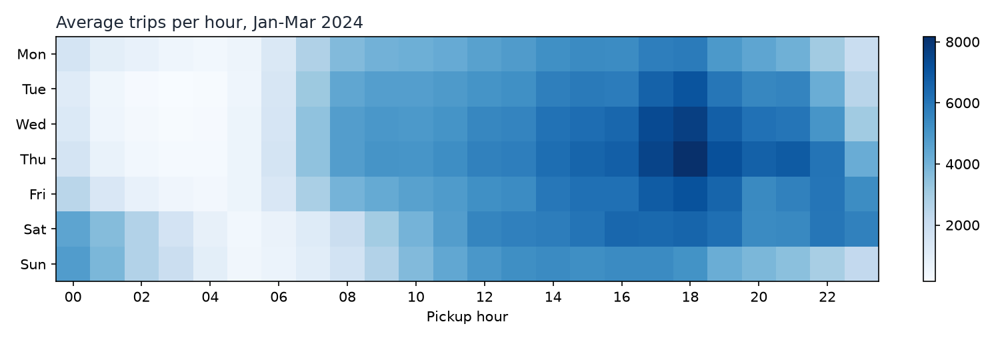
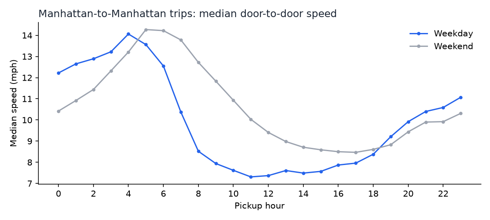
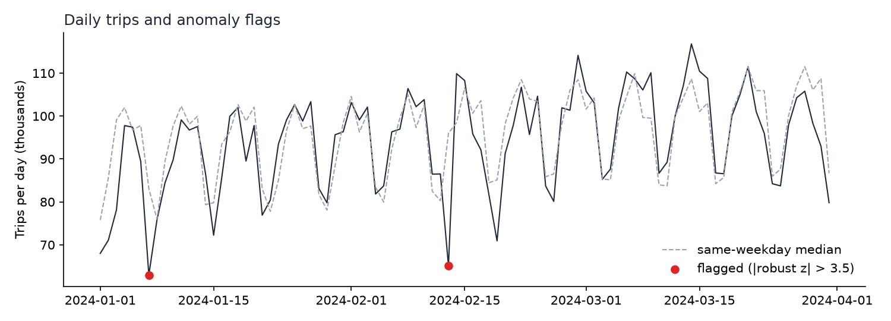

# Results — run of 2026-09-22

Produced by `nyctaxi analyze` on the checksum-verified January–March 2024 yellow-taxi files. Each SQL analysis scans all 9.55M rows in 0.3–1.0 s on a laptop, and the full command takes about 10 s including charts.

## 1. Data-quality audit

Rules are applied in order, and each row is labelled with the first rule it breaks, so the counts add up to the raw total.

| Rule | Trips | % | Total amount ($) |
|---|---:|---:|---:|
| 1 pickup outside Jan–Mar 2024 (pickups dated 2002, 2008, 2009, late December 2023, and April 2024) | 21 | 0.000 | 540 |
| 2 `payment_type 0` (no rate code, passenger count, or surcharges) | 751,962 | 7.870 | 18,059,980 |
| 3 non-positive fare or total (voids, refunds, disputes) | 118,086 | 1.236 | −2,980,457 |
| 4 duration not in (0, 180] minutes | 8,156 | 0.085 | 311,491 |
| 5 distance not in (0, 100] miles | 100,847 | 1.055 | 3,831,991 |
| 6 average speed over 80 mph | 2,825 | 0.030 | 136,157 |
| **7 clean** | **8,572,881** | **89.723** | **237,333,200** |

**The choice I would defend:** `payment_type 0` rows are excluded, not repaired. They are not one of the six payment codes in the classic TLC data dictionary. Every one of them has a `NULL` rate code, passenger count, and congestion surcharge, and they come from both main vendors (209,226 from vendor 1 and 542,016 from vendor 2). They look like a different kind of record, not damaged ordinary trips, and their tips cannot be attributed to card or cash. Excluding them costs 7.9% of rows. The alternative is mixing records whose meaning I cannot verify into every average.

## 2. Tipping

### The cash-tip trap

| Payment | Trips | Mean tip % | % with any tip |
|---|---:|---:|---:|
| All trips (naive) | 8,572,881 | 14.91 | 79.77 |
| Card | 7,190,382 | 17.78 | 95.11 |
| Cash | 1,274,969 | 0.00 | 0.00 |
| Dispute | 74,338 | 0.06 | 0.10 |
| No charge | 33,192 | 0.02 | 0.09 |

Cash tips are not recorded in this data, so every cash trip shows a $0 tip. Including them pulls the "average tip" down by about 3 percentage points. That drop is a measurement artifact, not stingier riders. Every other tip figure in this project is card-only.

### Preset buttons

A tip "matches" a preset p when it is within one cent of p × the pre-tip total, rounded to the cent.

| Tip | Tipped card trips | % |
|---|---:|---:|
| exactly 20% | 3,208,480 | 46.92 |
| exactly 25% | 435,164 | 6.36 |
| exactly 30% | 194,708 | 2.85 |
| any other amount | 3,000,183 | 43.87 |

**56.1% of tipped card trips are exactly a preset.** In the histogram of tip % (1-point bins), the 20% bin holds 3.84M trips, about 28 times the 138k in the 19% bin beside it. The smaller spikes at 10% and 15% are consistent with riders computing round numbers themselves.

**Which base does the tablet use?** I tested the candidate bases and kept the one that explains the most tips exactly:

| Base | % of tipped card trips matching a preset |
|---|---:|
| fare only | 3.23 |
| fare + surcharges + taxes (no tolls) | 47.90 |
| total − tip − tolls | 53.59 |
| **total − tip** (fare, surcharges, taxes, *and tolls*) | **56.13** |

The tolls-included base wins, which suggests the preset percentage is applied to the toll too. This is inferred from the data, not taken from a TLC specification.

## 3. Demand

The busiest slot is Thursday 18:00 (8,178 trips per hour on average). The quietest is Tuesday 03:00 (152), a 54× range. Weekday demand builds all day to an evening peak. Saturday and Sunday keep significant volume past midnight.

## 4. Manhattan speed

These are trips that start and end in Manhattan: median door-to-door speed, which includes stops and signals. It is a congestion proxy, not a traffic-sensor reading.

- Weekday: fastest 14.06 mph at 04:00, and slowest **7.31 mph at 11:00**. Speed stays between 7.3 and 8.0 mph from 10:00 to 17:00.
- Weekend: fastest 14.27 mph at 05:00, and slowest 8.47 mph at 17:00.

The weekday slowdown starts at 07:00 and lasts through the whole working day, rather than following the demand peak at 18:00.

## 5. Airports (a trip touching an airport zone at either end)

| | Trips | % trips | % revenue | Mean total ($) | Median minutes | Card tip % |
|---|---:|---:|---:|---:|---:|---:|
| Non-airport | 7,718,772 | 90.04 | 72.00 | 22.14 | 11.0 | 17.83 |
| JFK | 476,829 | 5.56 | 16.72 | 83.20 | 40.3 | 16.82 |
| LaGuardia | 357,537 | 4.17 | 10.23 | 67.87 | 26.8 | 17.94 |
| Newark | 19,743 | 0.23 | 1.06 | 127.22 | 35.5 | 16.33 |

Airport trips are about one in ten trips and more than a quarter of revenue.

## 6. Anomalous days

Each day is compared with the median of same-weekday days within ±21 days (itself excluded). Deviations are scaled by the median absolute deviation, and a day is flagged when |robust z| > 3.5.

| Date | Trips | Baseline | Robust z | Holiday? |
|---|---:|---:|---:|---|
| 2024-02-13 (Tue) | 65,099 | 95,984 | −5.26 | no |
| 2024-01-07 (Sun) | 62,956 | 83,131 | −3.94 | no |

New Year's Day (z −2.6 in the first version) and Presidents' Day (−2.7) were low but under the threshold. I did not bring in weather or event data, so the cause of the two flagged days is **not established here**.

**The first detector's output, kept for the record:** with a window-wide baseline it flagged 2024-01-02 (z −3.97), 2024-01-07 (−3.83), and 2024-02-13 (−4.92). The 2 January flag was mostly the January-to-March growth trend. The local baseline moves it to −2.72.

## Known limits

- One quarter, winter only. Seasonal patterns (summer tourism, school holidays) are not represented.
- Yellow taxis only. Ride-hail trips (Uber, Lyft) are in the separate HVFHV files and are not analysed.
- The ±21-day baseline is one-sided for the first and last three weeks of the window, so those days still carry some trend bias.
- "Speed" is trip distance divided by duration, and includes time spent stopped.
